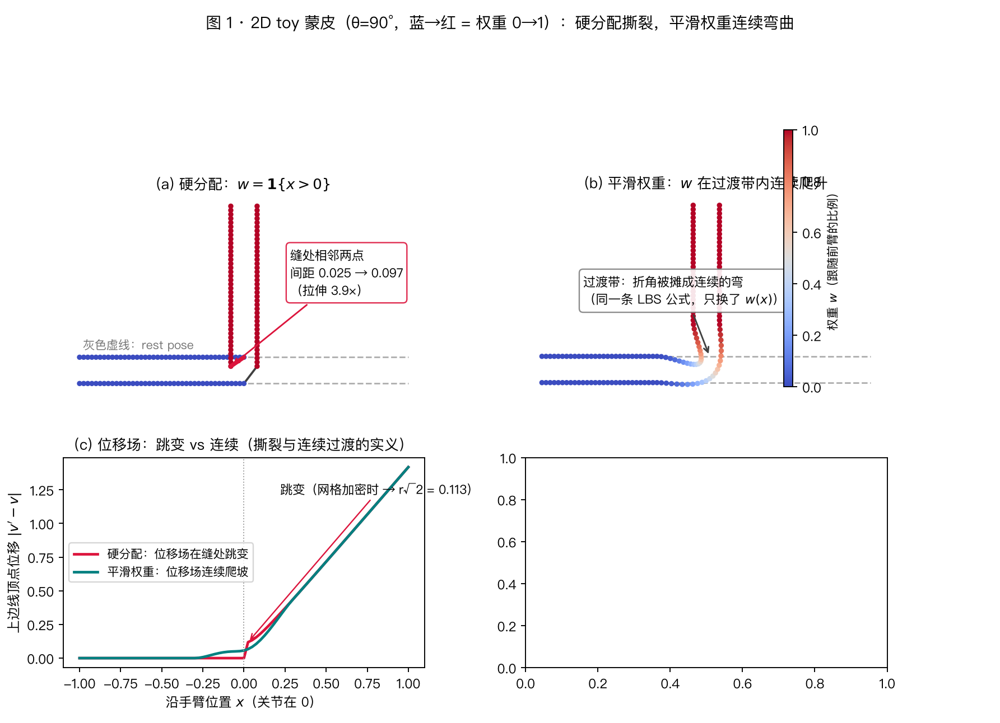
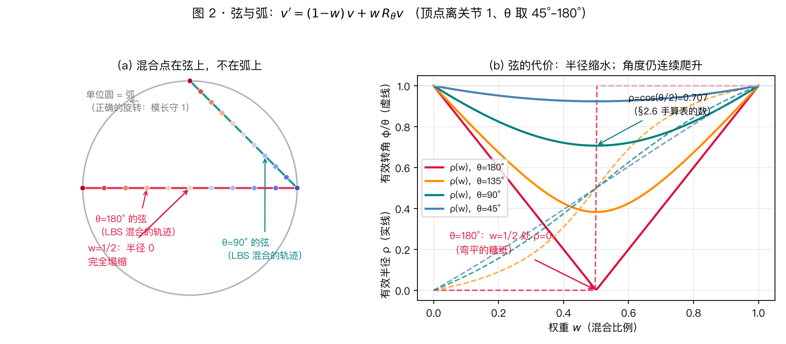

# GG 01：SMPL 人体模型与布料仿真基础

> 📖 本系列按主题分组精读 19 篇 garment generation 论文（2020–2026，TailorNet → GarmentoPIA）。本篇是两篇背景篇的第一篇：**身体怎么表示、布料怎么仿真**——这两个部件几乎是所有 19 篇论文的公共依赖。
> 阅读前提：线性代数、微积分、基础力学。不需要计算机图形学背景。
> 姊妹背景篇：[GG 02：缝纫版型表示法专题](../GG_02_pattern_representations/)（服装本身怎么表示）。

---

## 1. 这一篇解决什么问题？

把 19 篇论文摊开看，它们的 pipeline 千差万别，但拆到最底层，几乎每一篇都站在三个公共部件上：

1. **一个参数化人体**：服装是穿在身上的——身体是几乎所有方法的**条件输入**（TailorNet 的 shape/pose 分解、SewingLDM 的身体条件生成、Dress-1-to-3 的碰撞体）。领域的默认选择是 SMPL；
2. **一套布料物理**："服装生成"的终点不是"看起来像衣服的网格"，而是**可穿戴、可仿真（simulation-ready）**的 3D 资产。要评价"生成得像不像真衣服"，最终裁判是物理仿真；
3. **一个物理损失**：2021 年后的一整条技术线（PBNS → SNUG → DrapeNet → ISP）不再依赖仿真器生成训练数据，而是**把物理能量直接当损失函数**——这是本系列 GG 04 的主角。

本篇回答四个递进的问题：

1. **SMPL 到底是什么函数**？$\beta$、$\theta$ 怎么变成 6890 个顶点？LBS 蒙皮的"糖纸伪影"在数学上为什么必然发生？
2. **布料的物理是什么**？薄膜的拉伸/弯曲/碰撞能量怎么写？为什么显式积分器在布料上必然爆炸？
3. **求解器谱系**：PBS → PBD → XPBD → IPC，每一代在修上一代的什么病？（GarmentCodeData 用 XPBD、Dress-1-to-3 用可微 CIPC——不知道这些词，后面论文读不下去）
4. **物理损失自监督**是什么：不跑仿真器，让网络输出直接被物理能量惩罚？

**数值实验预告**：本篇三个实验全部有**解析答案**可对照——LBS 截面塌缩率 $\cos^2(\theta/2)$、XPBD 链式弹簧平衡伸长 $mg/k$、刚弹簧显式积分的爆炸步数。所有数字都来自实际运行的代码。

---

## 2. SMPL：人体作为低维参数函数

初学最容易把 SMPL 理解成"输入姿势 → 输出人体 mesh"——这个理解太粗糙。SMPL（Loper et al., 2015）的内部叠着**三层完全不同的东西**：

> **统计形状模型**（$\beta\to$ 体型）＋ **运动学骨架**（$\theta\to$ 骨骼刚体变换）＋ **蒙皮变形算子**（骨骼变换 $\to$ 表面顶点）。

一句话串起整条链：SMPL 定义"这个人长什么样、摆什么姿势" → 骨架给出各关节的刚体变换 → 蒙皮把骨架变换传播到人体表面 → 但蒙皮对旋转做**线性平均**会产生非刚性缩放/剪切 → 极端扭转处出现糖纸伪影。写成函数：

$$
M:\ \underbrace{\beta\in\mathbb{R}^{10}}_{\text{身份/体型}}\times\underbrace{\theta\in\mathbb{R}^{72}}_{\text{姿态（24 关节×3）}}\times\underbrace{\mathbb{R}^3}_{\text{全局平移}} \longrightarrow \mathbb{R}^{6890\times 3},
$$

输出固定拓扑网格（6890 顶点、13776 面）的顶点位置；核心公式

$$
M(\beta,\theta) = \mathrm{LBS}\big(\underbrace{\bar T + B_S(\beta) + B_P(\theta)}_{\text{静止网格（含两个修正项）}},\ \underbrace{J(\beta)}_{\text{关节位置}},\ \theta\big)
$$

里的五个部件（体型混合、关节回归、运动链变换、姿态修正、蒙皮）在 §2.2–2.5 逐一展开；§2.6–2.7 解析并数值验证糖纸伪影；§2.8 讲修复路线的取舍；§2.9 组装完整 forward；§2.10 划清 SMPL 的边界——它**不是**物理模型，这一条对服装研究尤其重要。每一小节只回答一个小问题，按序读就是一条从零到完整的路径。

### 2.1 模板与稠密对应：为什么必须固定拓扑

SMPL 的一切从一个**平均人体模板** $\bar T\in\mathbb{R}^{6890\times3}$ 出发——近似 T-pose 的标准人体（6890 个顶点各占一行 $(x_i, y_i, z_i)$）。它的关键性质不在"长什么样"，而在**所有 SMPL 人体共享同一套拓扑与顶点对应**：第 3500 号顶点在任何人、任何姿态的网格上都落在同一个语义位置（比如左肩某点）。于是任意两个人的网格可以逐顶点相减、逐顶点比较——$V^{A}_{3500}-V^{B}_{3500}$ 的含义是"这两人在这个解剖位置的差异"。这就是**稠密对应**（dense correspondence）：TailorNet 把服装注册成 SMPL 的子网格（GG 03）、SewingLDM 把 $\beta,\theta$ 当条件（GG 08）、Dress-1-to-3 优化"哪个身体尺寸最解释这件衣服"（GG 10），全都踩在这条性质上。

### 2.2 体型：$\beta$ 与 shape blend shapes

SMPL 不用显式人体测量（身高 180 / 体重 75 / 腰围 80 这类数），而用低维潜码 $\beta=[\beta_1,\dots,\beta_B]$——经典研究取 $B=10$（官方模型可提供多至 300 维），前 10 维已解释绝大部分方差。体型形变是基的线性组合：

$$
B_S(\beta)=\sum_{n=1}^{B}\beta_n\,S_n,\qquad S_n\in\mathbb{R}^{6890\times3},
$$

$S_n$ 是对数千次 3D 扫描做注册后、对静止姿态顶点位移做 PCA 得到的"体型基"。玩具版本（$B=2$：$S_1$ = 高矮方向、$S_2$ = 胖瘦方向）：

| $\beta$ | 效果（$v_i' = v_i + \sum_n \beta_n S_{n,i}$） |
|---|---|
| $(2, 0)$ | 全部顶点沿高矮方向挪两格 |
| $(0, -1)$ | 沿胖瘦反方向挪一格 |
| $(1.5, 0.5)$ | 两个方向按系数叠加 |

但必须清楚：**真实 PCA 基没有这么干净**——$\beta_1$ 不严格等于"高矮"、$\beta_2$ 不严格等于"胖瘦"，它们只是数据里方差最大的变化方向（"大致对应"而非"定义"）。到这里得到**分好体型的静止人体**：$T_S(\beta)=\bar T+B_S(\beta)$。

### 2.3 骨架：关节回归与轴角

**为什么骨架必须跟着 $\beta$ 变？**（初学者最容易忽略的一问）一个 1.5 米和一个 2 米的人，hip→knee 的距离显然不同——不可能所有体型共享一套固定关节坐标。SMPL 用**关节回归器**（joint regressor）从分好体型的网格上"量"出关节：

$$
J(\beta)=\mathcal J\big(\bar T + B_S(\beta)\big),\qquad \mathcal J\in\mathbb{R}^{24\times6890},
$$

即**每个关节 = 一组顶点的加权组合**（示意：$J_{\text{knee}}\approx 0.2\,v_{100}+0.3\,v_{101}+0.5\,v_{102}$；公开模型里的 `J_regressor` 就是这个矩阵）。展开就是线性形式 $J(\beta)=\bar J+\sum_n\beta_nJ_n$（$\bar J=\mathcal J\bar T$、$J_n=\mathcal J S_n$）——体型一变，肩宽腰位自动跟着变。一个要点：**关节不是某个 mesh 顶点**——它通常位于身体内部（膝盖中心在皮肤里面）。

**关节数的算术**：$24 = 1 + 23$——1 个骨盆根关节（其旋转 $R_0$ 是全局朝向）+ 23 个相对父关节的铰接关节。所以参数 $\theta\in\mathbb{R}^{24\times3}=\mathbb{R}^{72}$（每关节一个 3 维轴角），而 §2.4 的姿态修正特征却是 $23\times9=207$ 维——两个数字并不矛盾（一个是全部 24 个关节的轴角参数，一个是 23 个非根关节的旋转矩阵元素），初见时的困惑在此一次说清。

**轴角 → 旋转矩阵**：关节旋转写成轴角向量 $\omega_k\in\mathbb{R}^3$——$\|\omega_k\|$ 是转角、$\omega_k/\|\omega_k\|$ 是转轴（例：$\omega=(0.3,0,0)$ = 绕 $x$ 轴转 0.3 rad），经指数映射 / Rodrigues 公式 $R_k=\exp([\omega_k]_\times)\in SO(3)$ 变成真正的旋转矩阵。（勘误一则：SMPL 原论文的 Rodrigues 公式有一处印刷错误，官方已发布 errata——二阶项系数应为 $1-\cos\|\omega\|$。照 2015 原文抄公式时注意。）

### 2.4 姿态修正：$B_P(\theta)$ 为什么长这样

**为什么"骨头转了"还不够？** 手臂从 $0^\circ$ 弯到 $90^\circ$，真实人体还有肌肉挤压、皮肤拉伸、肘窝凹陷、关节附近体积变化——纯骨架刚体变换给不出这些。SMPL 的答案是**姿态混合形状**（pose blend shapes）：在蒙皮**之前**，先按当前姿势把网格修一下。它有两个值得推敲的刻意设计：

1. **特征用 $R-I$，不用原始角度**。把 23 个非根关节的旋转矩阵各减单位阵再展平：
$$
r(\theta)=\mathrm{vec}\big(R_1-I,\ \dots,\ R_{23}-I\big)\in\mathbb{R}^{207},\qquad
B_P(\theta)=P\,r(\theta),\quad P\in\mathbb{R}^{20670\times207}.
$$
   rest pose 时 $R=I\Rightarrow r=0\Rightarrow B_P(0)=0$——模板姿态天然不需要修正，零点"免费"；代价是"$B_P$ 对矩阵元素线性、对关节角度非线性"这句话必须拆开才懂（下方展开）。
2. **修正发生在 LBS 之前**：先把关节处的网格修好（比如肘部撑胖一点），再交给蒙皮搬运。顺序不是随意的——$B_P$ 学的是"预支 LBS 将要犯的错"（§2.8 展开），必须在错误发生之前注入。

**"两个线性，一个非线性"——链条拆解**。从角度到修正量要经过三环：

$$
\underbrace{\omega_k}_{\text{角度}}\ \xrightarrow{\text{Rodrigues（非线性）}}\ \underbrace{R_k(\omega_k)}_{\text{矩阵元素}}\ \xrightarrow{\text{减}I\text{、展平}}\ r(\theta)\ \xrightarrow{\ P\ \text{（线性）}\ }\ B_P .
$$

非线性全部集中在**第一环**。最简单的例子：肘部只绕 $x$ 轴弯，转角 $\theta$（附录 A.3）：

$$
R_x(\theta)=\begin{bmatrix}1&0&0\\0&\cos\theta&-\sin\theta\\0&\sin\theta&\cos\theta\end{bmatrix}
$$

9 个元素里只有 4 个在动——盯住 $(r_{22},r_{32})$，让 $\theta$ 从 $0$ 扫到 $2\pi$：

| $\theta$ | $r_{22}=\cos\theta$ | $r_{32}=\sin\theta$ | 参数点走到 |
|---|---|---|---|
| 0° | 1 | 0 | 出发点 |
| 90° | 0 | 1 | 1/4 圆 |
| 180° | −1 | 0 | 对跖点 |
| 270° | 0 | −1 | 3/4 圆 |
| 360° | 1 | 0 | **回到出发点——闭合** |

这就是"这 9 个数走出一条**闭合曲线**"的真身：躺在 9 维空间一张二维平面上的**圆**。它不是 $x$ 轴特例——Rodrigues 公式 $R=I+\sin\theta\,[u]_\times+(1-\cos\theta)\,[u]_\times^2$ 展开后，每个元素都形如

$$
r_{ij}(\theta)=c_{ij}+a_{ij}\cos\theta+b_{ij}\sin\theta
$$

（常数 + 一组 $\cos$ + 一组 $\sin$）：9 维点在一张二维仿射平面上画圆，**圆心 = 常数项 $(c_{ij})$**，半径与朝向由转轴 $u$ 决定。与反例特征（原始轴角）的轨迹一对照，刻意设计的动机就全露出来了：

| | $r(\theta)$（SMPL 实选） | $\omega$（反例 $B_P=P\omega$） |
|---|---|---|
| 轨迹形状 | 圆 | 射线（随 $\theta$ 匀速走远，永不回头） |
| 有界 | ✓ 拴死在圆上（附录 A.2 的模长守恒 $\tfrac{d}{d\theta}\|p\|^2=0$） | ✗ 无限走远 |
| 周期 | ✓ 转满一圈首尾相接 | ✗ 每一度都是新位置 |
| 线性层 $P$ 组合出的修正 | $\cos/\sin$ 的加权和：**饱和**（弯到 90° 后自动放缓）+ **周期**（转满一圈回原状） | "角度 × 常数"：不饱和、无周期，学不出"弯到头就不再多弯" |

而线性发生在**最后一环**：$B_P=Pr$ 只是"207 个矩阵元素 × 固定系数，再对 207 项求和"——矩阵 $P$ 从头到尾不知道角度是什么，它只对"已经算好的数字"做加权平均。所以"$B_P$ 对矩阵**元素**线性"指这一环（给定 $r$，$B_P$ 是 $r$ 的线性函数）；"对关节**角度**非线性"指整条链的复合（$r$ 的每个元素都是 $\theta$ 的三角函数，线性映射拉不直它们）。**先把非线性"预付"进特征，再让最简单的一层线性映射去组合它**——比直接堆非线性网络便宜且可控，也是 SMPL 全篇 "Linear" 哲学的又一次落地。

**"姿态修正"不是"摆姿势"——初学最易混淆的一处**。看到 $T_P(\beta,\theta)$ 的自变量里有 $\theta$，很容易以为这一步已经把姿势摆好了——**没有**。$B_P(\theta)$ 是毫米级的**局部**修正（肘弯内侧捏一点、上臂肌肉鼓一点），不含任何大范围的旋转；摆姿势是下一节 LBS 的事。拿捏假人模型类比，三步各自在干什么：

| 步骤 | 干什么 | 假人此时 |
|---|---|---|
| $B_S(\beta)$ | 捏胖捏瘦、拉高拉矮 | T-pose 站立 |
| $B_P(\theta)$ | 照"将要摆的姿势"预捏肘部撑胖、肩头压扁 | **还是 T-pose，手臂没弯** |
| LBS（§2.5） | 把手臂绕关节转过去 | 姿势完成 |

```text
T-pose:   ●━━━━■━━━━●        ■ = B_P 在 T-pose 肘部位置预捏的修正
               │ LBS 绕肘转 90°
               ▼
弯折后:   ●━━━━■╮             ■ 被一起转过去 → 恰好落在肘弯的正确位置
```

顺序为什么必须如此：肌肉鼓包、关节修正要出现在**旋转之后**的正确解剖位置，而 $B_P$ 作用在旋转**之前**的网格上——必须"提前"把修正捏在 T-pose 对应位置（顺带预支了 LBS 在关节处会犯的塌缩错误，§2.8）。

到这里，蒙皮前的全部准备就绪：$T_P(\beta,\theta)=\bar T+B_S(\beta)+B_P(\theta)$——注意它**还躺在模板姿态里**，手臂并没有真的转过去（$B_P$ 只是预捏了关节处的修正）；让整个人动起来是下一节蒙皮的事。

### 2.5 蒙皮：LBS 从零开始

**先看单骨骼为什么"没什么可讲"**。顶点若只受一根骨骼影响（$w_{i,k}=1$），齐次坐标下

$$
\tilde v' = A_k\,\tilde v,\qquad A_k=\begin{pmatrix}R_k & t_k\\ 0 & 1\end{pmatrix}
$$

就是 $v'=R_kv+t_k$——无缩放、无剪切，物理上无懈可击。更强的是：建模时可以直接把这根骨骼的 rest 坐标系**设成**世界系（关节放原点、骨骼沿 $x$ 轴），一切"出厂位置"信息都被坐标选择吸收——单骨骼的世界里连 bookkeeping 都是免费的。

**多骨骼改变了什么**：同一张网格的不同区域要跟随**不同**骨骼。有三样东西从此吸收不掉、必须显式处理，本节剩下的内容就是它们的逐条展开：

| | 单骨骼 | 多骨骼（SMPL 24 根） |
|---|---|---|
| 网格怎么动 | 整张网格跟随**唯一**一个刚体变换 | 不同区域跟随不同骨骼，各区域内部仍是刚体 |
| rest 坐标系 | 可设成世界系（$G_k(0)=I$） | 24 根骨骼 24 个 rest 位置，不可能都是 $I$ → **inverse bind 显式化**（下文"易漏的一步"） |
| 骨骼间关系 | 无 | 腕跟着肘、肘跟着肩 → **变换沿链累乘**（运动树） |
| 关节处 | 无关节 | 两根骨骼各转各的，硬分配（$w\in\{0,1\}$）会在关节**撕裂** → **必须平滑混合** → LBS（本节主角，也是糖纸伪影的唯一来源） |

**积木：骨头不绕世界原点转**。想让手臂绕肘关节 $J$ 转，正确操作是 $R(v-J)+J = Rv+\underbrace{(J-RJ)}_{t_k}$——骨骼变换的平移项把"旋转中心在关节处"编码了进去。

**骨架是运动树**：

```text
pelvis
├── left hip  → left knee  → left ankle
├── right hip → right knee → right ankle
└── spine → chest → left/right shoulder → elbow → wrist
```

肘相对肩、腕相对肘定义（每关节的旋转都在父关节坐标系里），全局变换沿树递归累乘：

$$
G_k = G_{\mathrm{parent}(k)}\,G_k^{\mathrm{local}},\qquad
G_k^{\mathrm{local}}=\begin{pmatrix}R_k & J_k-J_{\mathrm{parent}(k)}\\ 0 & 1\end{pmatrix}.
$$

**易漏的一步：inverse bind——两步换系，不是一步变换**。$G_k$ 的语义是"**骨骼局部坐标 → 当前世界坐标**"——它期望的输入是骨骼自己坐标系里的点；而网格顶点存的是 **rest 世界坐标**，两套语言不通。正确操作分两步：

$$
v' \;=\; \underbrace{G_k(\theta)}_{\text{骨局部}\to\text{当前世界}}\;\underbrace{G_k(0)^{-1}}_{\text{rest 世界}\to\text{骨局部}}\;v,
\qquad
A_k = G_k(\theta)\,G_k(0)^{-1},
$$

$G_k(0)^{-1}$ 就是游戏引擎里的 **inverse bind matrix**：把顶点从 rest 世界坐标翻译回"这根骨骼出厂坐标系"里的位置——即顶点**焊在骨骼上的相对位置**。为什么它最容易漏：$\theta=0$ 时 $A_k=I$、$v'=v$（rest pose 原样不动 ✓，什么都不做结果也对）；单骨骼时它还能整个消失（骨系 = 世界系 ⟹ $G(0)=I$ ⟹ inverse bind = $I$）——只有"多骨骼 + 一张共享 rest 网格"才逼它现身。

**手算一遍**（2D：肘关节 $J=(1,2)$，前臂沿 $x$ 轴，rest 时骨系原点在肘、轴向与世界系对齐；前臂上一点 $v=(4,2)$，即离肘 3 个单位。把前臂绕肘逆时针转 $90^\circ$）：

| 步骤 | 计算 | 结果 |
|---|---|---|
| ① $G(0)^{-1}v$：回骨系 | $(4,2)-(1,2)$ | $(3,0)$——"焊在骨上 3 单位处" |
| ② $G(\theta)\cdot(3,0)$：出当前骨系 | 旋转 $90^\circ$，再平移 $(1,2)$ | $(1,5)$ ✓（绕 $(1,2)$ 转：$(3,0)\to(0,3)$） |
| ❌ 跳过①，直接 $G(\theta)v$ | 把世界系坐标当骨系坐标用 | $(-1,6)$——转的是"离肘 4 右 2 上"的点，凭空错位 |

表中 ❌ 行的错位能精确记账：直接乘给出 $Rv+J$，正确答案是 $R(v-J)+J$，两者之差**恰好是 $R\,J$**——本例 $R(1,2)=(-2,1)$，正等于 $(-1,6)-(1,5)$。也就是说：顶点世界坐标里那部分"骨头出厂摆放"（肘坐在 $(1,2)$）被当成骨上几何**又转了一遍**——"直接 $G_kv$ 会把出厂位置也乘上去"说的就是这笔账。链式情形更隐蔽：$G_k(\theta)$ 沿运动树累乘，平移列里叠着一路的 rest 关节偏移；$\theta=0$ 时所有旋转都是 $I$，但 $G_k(0)\neq I$（纯平移的出厂摆放）——所以 $G_k(\theta)$ 天生是"当前旋转 $\circ$ 出厂摆放"的复合，而世界坐标顶点**本来就含**出厂摆放，直接乘 = 出厂摆放被算了两遍。$G_k(0)^{-1}$ 的全部职责：消掉多余的那一遍。

两步合起来 $A_k=G(\theta)G(0)^{-1}$ 展开恰好是 $\begin{pmatrix}R & J-RJ\end{pmatrix}$——**就是上面那块积木 $R(v-J)+J$**：同一个矩阵的两种读法，"绕点转"看见的是旋转中心平移，"换系"看见的是先回骨系再出来。多骨骼下没法再逐个手推"绕哪个点转"（24 根骨骼、链式依赖），但"两步换系"的读法逐字保留在代码里——引擎实现的永远是 $G_k(\theta)G_k(0)^{-1}$，不是手推的 $R(v-J)+J$。

**关节附近必须混合**。最简单的分配是**硬分配**：每个顶点整份只属于一根骨骼，权重只能是 0 或 1——"100% 上臂"即 $w_{\text{上臂}}=1$、其余为 0。问题出在关节缝两侧。前臂绕肘转 90°：

| 顶点 | 硬分配 | 转后 |
|---|---|---|
| 缝上方 1mm 的 $a$ | 100% 上臂（不动） | 原地 |
| 缝下方 1mm 的 $b$ | 100% 前臂（转 90°） | 沿半径 ≈ 手臂半径的圆弧被带走（$b$ 虽离缝仅 1mm，但它是**表面**点——离旋转轴约一个手臂半径，位移 $\sqrt2\,r\approx$ 几厘米） |

静止时 $a,b$ 相距 2mm；一转，距离跳到几厘米。**距离会变本身不是问题**——弯肘时外侧皮肤本来就拉伸；病在**量级、分布与连续性**：

| | 真实皮肤 | 硬分配 |
|---|---|---|
| 拉伸量 | 百分之几到几十 | 跨缝三角形局部拉长 **10–50 倍** |
| 分布 | 摊在整个关节区几厘米范围 | 全部压进 2mm 宽的缝带 |
| 位移场 | **连续**（皮肤上无运动跳变线） | **跳变**（缝两侧位移从 0 跳到几厘米） |

表面于是不再像一根弯管，而像两段刚管中间绷一片硬拉出来的膜——肘外侧拉出尖刺状褶、内侧两段表面互相穿透，视觉上像裂开，故称"撕裂"（网格连通性其实没坏，还是一张连通网格；坏掉的是**几何**）。**为什么不"补面片/重网格拟合皮肤延展"？** ① 蒙皮的契约是**固定拓扑、只动顶点位置**——换来 GPU 常数开销、完全可微、引擎管线原生兼容；每帧改连通性、按弹性拟表面 = 物理仿真的世界（§3–4 的布料正是那么做的，代价差几个量级）。② 即便允许重网格，仍需回答"皮肤该在哪"——那是弹性力学问题，权重混合就是它最便宜的 kinematic 近似。③ SMPL 特有：全部学习组件（$S$、$P$、$\mathcal W$ 都是固定形状矩阵）假设 6890 个顶点永久固定，拓扑一变全部作废。实践中艺术家确实在关节附近加密顶点环，但只在**配合平滑权重**时有用——加密提供采样点，过渡本身仍由权重提供。

真实皮肤的真实做法是**连续过渡**：沿手臂表面画一排记号点再弯肘——肩附近的记号完全跟肩走、腕附近的完全跟腕走，肘区记号的"跟随前臂转角的比例"从 0 连续变到 1（外侧略少、内侧略多——拉伸与堆积的二阶差异；关键是连续性本身）。LBS 让权重 $w$ 直接扮演这个"跟随比例"：变换对 $w$ 连续 ⟹ 相邻顶点 $w$ 只差一点 ⟹ 位移差有界——相对旋转摊到整个过渡带而非集中在一条缝上，带内顶点的有效转角随 $w$ 连续爬升：

| $w$（跟随前臂的比例） | 0 | 0.25 | 0.5 | 0.75 | 1 |
|---|---|---|---|---|---|
| 有效转角（$\theta=90^\circ$） | 0° | ≈18° | 45° | ≈72° | 90° |

（精确值 $\arg\!\big(1{-}w{+}w\,e^{i\theta}\big)$；$w=\tfrac12$ 时恰为 $\tfrac\theta2$——§2.6 半角公式的那一格。）缝正上方 $(0.7,0.3)$、正下方 $(0.3,0.7)$，关节带从"两段刚管一个折角"变成一截连续的弯。代价在 §2.6：每个混合点落在两种摆放的**弦**上而非弧上（上文凸组合/凸包的直接后果），弦比弧短——糖纸伪影。所以每个顶点带一组非负、归一的权重 $w_{ik}\ge0$、$\sum_k w_{ik}=1$（权重矩阵 $\mathcal W\in\mathbb{R}^{6890\times24}$），**线性混合蒙皮**（Linear Blend Skinning, LBS）：

$$
v' = \sum_{k=1}^{K} w_{ik}\,A_k\,\tilde v
\;=\;\Big(\underbrace{\textstyle\sum_k w_{ik}A_k}_{\text{混合变换}}\Big)\tilde v .
$$

**为什么是"每行和为 1"，而不是"每列模长为 1"？** $\mathcal W$ 的行与列是两种不同的东西：

| | 第 $i$ 行（6890 行） | 第 $k$ 列（24 列） |
|---|---|---|
| 语义 | 顶点 $i$ 的**分账单**：被各骨骼瓜分的份额 | 骨骼 $k$ 的**势力范围**：在整张网格上的影响场 |
| 合理约束 | 非负 + $\sum_k w_{ik}=1$（份额凑满 100%） | 没有理由是 1——肘骨管几百个顶点、骨盆管几千个 |

行归一不是"诸多约定里选了一个"，而是被 **rest pose 检验**逼出来的唯一选择：$\theta=0$ 时所有 $A_k=I$，上式退化为 $v'=(\sum_k w_{ik})\,v$——行和为 1 ⟺ rest 网格原样不动；行和 1.5 → 该顶点在 rest pose 原地放大 50%，行和 0 → 顶点塌到原点。列模长为 1 对此**完全无防护**（它与任意行总和相容），它约束的是"每根骨骼的总影响力"，而问题里没有任何东西要求 24 根骨骼影响力相等。几何读法：非负 + 行和 1 = **凸组合**（convex combination——"不许超配、不许反着配"的加权平均：$0.7p_1+0.3p_2$ 是；$2p_1-p_2$ 不是（负系数）、$0.6p_1+0.6p_2$ 也不是（和 1.2，会放大）），$v'$ 必落在各骨骼单独放置 $\{A_k\tilde v\}$ 的**凸包**（convex hull——"用橡皮筋把候选点全部箍住"圈出的区域：两点的凸包 = 线段，三点的 = 实心三角形）内——LBS 是在候选摆放之间**插值**，不凭空放大（反例正是坏权重：行和 1.5 把顶点推到凸包外面）。对照 $\beta$：$B_S=\sum_n\beta_nS_n$ 里 $\beta$ 是自由系数、$S_n$ 的列是**方向**（可任意伸缩，无需归一）；$\mathcal W$ 的行是**份额**——份额的定义就是凑满。

最后这个改写暴露了本质：**LBS 是在对变换矩阵直接做加权平均**。它实现极简、GPU 极快、完全可微、所有引擎原生支持（SMPL 选它正是为了接进工业动画管线）——但也正是 $\sum_k w_kA_k$ 这一步，埋下了糖纸伪影的全部种子（下节）。

**跑一遍看**（2D toy：带厚度的手臂，上臂恒等、前臂绕肘转 90°，只换权重 $w(x)$；脚本 `scripts/garment_generation_experiments/gg01_lbs_viz.py`）：



顶点颜色 = 权重 $w$（蓝 0 → 红 1）。(a) 硬分配：红蓝分界就是关节缝——缝下顶点整体被前臂带走、缝上原地不动，跨缝相邻两点间距从 0.025 拉到 0.097（**3.9×**），位移场 (c) 在缝处竖直跳变（本例跳变 0.119；网格无限加密时趋于 $r\sqrt2=0.113$，即表面点绕轴转 90° 的位移）——这就是"几何撕裂"。(b) 同一条 LBS 公式、只把 $w$ 换成过渡带内连续爬升：折角被摊成连续的弯，位移场连续爬坡，局部最大拉伸只有 **1.32×**。撕裂（3.9×、位移跳变）与连续（1.32×、无跳变）的差别，全部来自 $w(x)$ 一个函数。

### 2.6 糖纸伪影：一个必然的数学事实

问题出在 §2.5 末尾那一步：旋转群 $SO(3)$ **不是凸集**——$R_1,R_2\in SO(3)$ 满足 $R^\top R=I$、$\det R=1$，但 $R=\tfrac12R_1+\tfrac12R_2$ 一般两条都不满足。**两个合法旋转的线性平均通常不是旋转**，可能偷偷夹带缩放与剪切；落到皮肤上就是伪影。设关节在原点，骨骼 1 恒等、骨骼 2 绕轴 $\mathbf a$ 旋转角 $\theta$，权重 $(1-w, w)$，则

$$
v' = (1-w)\,v + w\,R_\theta v.
$$

把 $v$ 分解为平行/垂直于旋转轴的分量：$v = v_\parallel + v_\perp$。旋转不动 $v_\parallel$，在垂直平面（2D）上 $R_\theta$ 是平面旋转。于是垂直平面上的有效变换是 2×2 矩阵 $(1-w)I + wR_\theta$——**恒等与旋转的凸组合**。对 $w=\tfrac12$ 用半角公式：

$$
\tfrac12\big(I + R_\theta\big) = \cos\tfrac{\theta}{2}\; R_{\theta/2},
$$

即"旋转一半的角度 + 整体缩放 $\cos\tfrac{\theta}{2}$"。**关节处的横截面面积按 $\cos^2\tfrac{\theta}{2}$ 塌缩**：弯 90° 面积剩一半，弯 180° **完全塌成一条线**——这就是"糖纸伪影"（candy-wrapper artifact）。一般权重的塌缩率为

$$
\text{截面半径缩放} = \sqrt{1 - 2w(1-w)(1-\cos\theta)}\quad\Big(\theta=\pi \text{ 时} = |1-2w|\Big),
$$

权重越平均（$w\to\tfrac12$）塌得越狠——**关节中部顶点（权重接近对半）受伤最重**，这与实际观察到伪影集中于关节中线完全一致。

**扭转（twist）是同一数学的更典型形态**。糖纸伪影最常出现在绕骨轴扭转处：设圆柱形手臂两端骨骼绕骨轴反向各转 $\pm\alpha$，中间顶点权重对半：

$$
R_{\mathrm{blend}}=\tfrac12R(+\alpha)+\tfrac12R(-\alpha)=\begin{pmatrix}\cos\alpha & 0\\ 0 & \cos\alpha\end{pmatrix}=\cos\alpha\,I
$$

——**旋转彻底消失，只剩纯缩放**。两骨骼相对扭转 $\varphi=2\alpha$ 时截面半径 $r'=r\cos\tfrac\varphi2$：扭 $180^\circ$ 半径归零，圆柱被拧成一条线——糖果包装纸两端一拧、中间收细，伪影由此得名。这个 $\cos\tfrac\varphi2$ 与上面弯折公式的 $\cos\tfrac\theta2$ 同源：把顶点分解到旋转轴的平行/垂直方向后，弯与扭都归结为"2D 恒等与旋转的凸组合"。

**一个更刺眼的极端**：$R_1=I$、$R_2$ 绕轴转 $180^\circ$ 时，$\tfrac12(I+R_2)=\mathrm{diag}(1,0,0)$——行列式为 **0**，混合变换**不可逆**：整根圆柱塌缩到轴线上。LBS 在极端处制造的是奇异变换，不是"有点不准"。

**弦与圆弧——一个能手算的例子**。单位圆上相隔 90° 的两点 $A=(1,0)$、$B=(0,1)$，线性平均：

| | 坐标 | 模长 | 方向 |
|---|---|---|---|
| $A$ | $(1,0)$ | 1 | 0° |
| $B$ | $(0,1)$ | 1 | 90° |
| 平均 $(A+B)/2$ | $(0.5,\,0.5)$ | $\mathbf{0.7071}$ | $\mathbf{45°}$ |

方向恰好对（45° = 半角），模长缩水 $0.7071=\cos\tfrac{90^\circ}{2}$——**半角公式的数字版**：线性平均 = "转对一半的角度 + 缩掉 $\cos\frac\theta2$"，截面面积（模长的平方）即 $\cos^2\frac\theta2$。一般图景：单位圆上两点做线性插值 $p(t)=(1-t)p_1+tp_2$，轨迹是**弦**（钻进圆内部，$\|p(t)\|<1$）；正确的旋转插值应沿**圆弧**走、保持模长 1。$SO(3)$ 是弯曲的流形，LBS 的 $\sum_k w_kR_k$ 恰恰是在流形上"走弦"——塌缩率就是弦相对弧的模长亏损。

把整条弦画出来（同一脚本图 2；顶点离关节距离 1，$w$ 从 0 扫到 1）：



(a) 每个 $w$ 的混合点 $v'=(1{-}w)v+wR_\theta v$ 落在弦上、按 $w$ 着色：θ=90° 的弦在 $w=\tfrac12$ 处离圆心 $\cos45^\circ=0.707$（上面手算表的数），θ=180° 的弦恰好穿过圆心——$w=\tfrac12$ 时**半径塌到 0**，手臂弯平成一条线。(b) 两条曲线把 LBS 的功与过同时摊开：**虚线（有效转角 $\varphi=\arg(1{-}w+we^{i\theta})$）从 0 连续爬到 θ**——这是 LBS 买到的连续性（图 1b 的弯就是这么来的）；**实线（有效半径 $\rho=|1{-}w+we^{i\theta}|$）在中间下凹**——这是付出的代价（糖纸塌缩）。$w=0$ 或 $1$ 时 $\rho=1$（单骨骼、无混合、无塌缩），只有过渡带内付利息。

**两类伪影要分开数**：

| | twist（绕骨扭转） | bend（绕关节弯曲） |
|---|---|---|
| 数学形态 | 半角公式：$\tfrac12(R_{2\theta}+I)=\cos\theta\,R_\theta$——截面面积 $\cos^2\theta$ | 两骨骼把顶点带到不同位置，线性平均 = 欧氏直线中点 |
| 症状 | **截面塌缩**（糖纸拧细） | **关节体积损失**，内外侧被夹瘪（SMPL 原论文的 taffy/bowtie 效应） |
| 正确行为应是 | 纯旋转，截面不变 | 皮肤绕关节滑动、保体积 |
| 出处 | 上面 §2.6 前半的推导 | 同一根源（$\sum_k w_kR_k\notin SO(3)$）的另一种表现 |

修复路线的取舍见 §2.8。

### 2.7 数值实验 1：糖纸伪影逐角度验证

设置：关节处一圈 64 个顶点（半径 1，垂直于骨骼轴），两骨骼 $w=(0.5,0.5)$，扫描弯折角，比较 LBS 变换后多边形面积与解析预测 $\cos^2\tfrac\theta2$：

| 弯折角 $\theta$ | 实测截面面积比 | 解析 $\cos^2\frac{\theta}{2}$ |
|---|---|---|
| 0° | 1.0000 | 1.0000 |
| 30° | 0.9330 | 0.9330 |
| 60° | 0.7500 | 0.7500 |
| 90° | 0.5000 | 0.5000 |
| 120° | 0.2500 | 0.2500 |
| 150° | 0.0670 | 0.0670 |
| **180°** | **0.0000** | **0.0000** |

七个角度**逐位吻合**；推广公式（$\theta=180°$ 时面积比 $=|1-2w|^2$）在 $w=0.1/0.3/0.5$ 下实测 0.6400/0.1600/0.0000，与解析值完全一致。伪影不是"实现得不好"，是 LBS 这个算子的固有谱性质。

### 2.8 DQS 与 SMPL 的选择：为什么"数学上更对"没有赢

**DQS**（Dual Quaternion Skinning, Kavan et al. 2007）的动机很自然：刚体变换属于 $SE(3)$，希望混合后**仍是刚体变换**。用对偶四元数 $\hat q=q_r+\epsilon q_d$ 表示刚体变换（$q_r$ 是旋转四元数；平移编码在 $q_d=\tfrac12\,t_qq_r$ 里，$t_q=(0,t_x,t_y,t_z)$ 为纯四元数），混合后归一化：

$$
\hat q=\frac{\sum_k w_k\hat q_k}{\big\|\sum_k w_k\hat q_k\big\|},
$$

归一化后的 $\hat q$ 仍精确对应一个刚体变换——twist 塌缩从根上消失。但代价是 **bulging**：归一化平均过度坚持刚性与保体积，而真实人体不是刚体（肘弯 90° 时软组织应当挤压），关节处反而向外鼓包（机理推演见习题 3）。**病没有被治好，只是搬了家。**

**SMPL 为什么仍选 LBS？** 因为 SMPL 从来不是裸 LBS，而是

$$
\text{LBS}+\text{learned pose corrective }B_P(\theta).
$$

$B_P$ 是**在 LBS 这个前向模型下学出来的逆补偿**：LBS 会让肘部收缩，$B_P$ 就提前把肘部撑胖一点——"预支的撑胖 + LBS 的收缩 ≈ 真实人体"。一旦把 LBS 换成 DQS，等于换掉整个前向模型，这套为 LBS 量身学习的补偿立刻失效。官方 FAQ 说得直白：公开的 SMPL-LBS 整体精度优于其 SMPL-DQBS 版本，且 LBS 更简单、更标准。两条路线的账本：

| | DQS | SMPL-LBS（+ $B_P$） |
|---|---|---|
| 混合结果 | 严格刚体变换（$SE(3)$ 封闭） | 一般仿射变换（可夹带缩放/剪切） |
| twist 塌缩 | ✓ 从根上消失 | ✗ 存在，但被 $B_P$ 预先补偿 |
| bulging 鼓包 | ✗ 归一化平均的代价 | 无此病 |
| 与学习组件的兼容 | 换掉前向模型 → 量身学习的 $B_P$ 失效 | $B_P$ 正是为 LBS 学的 |

**通用教训：修正项与变形模型是绑定的——把"数学上更正确"的组件换进一个学出来的系统，未必更好。**

### 2.9 完整 forward：计算图与 tensor 清单

把 §2.1–2.5 组装成一张图：

```text
β ──B_S(β)──> v_shaped = T̄ + B_S(β) ──J(β)──> 关节 J
                     │
                     └──B_P(θ)──> v_posed = v_shaped + P·r(θ)

θ ──Rodrigues──> R_k ──FK(θ, J)──> A_k = G_k(θ,J)·G_k(0,J)⁻¹

V = LBS(v_posed, A, W)：  v_i = Σ_k w_ik·A_k·ṽ_posed,i
```

公开 SMPL 模型文件就是这五个矩阵（PyTorch 实现里逐个对得上）：

| tensor | 形状 | 对应 |
|---|---|---|
| `v_template` | 6890×3 | 模板 $\bar T$ |
| `shapedirs` | 6890×3×10 | 体型基 $S_n$ |
| `J_regressor` | 24×6890 | 关节回归 $\mathcal J$ |
| `posedirs` | 6890×3×207 | 姿态修正基 $P$（$20670\times207$ 的三维存放） |
| `weights` | 6890×24 | 蒙皮权重 $\mathcal W$ |

（另有 `faces`：13776×3，固定拓扑。）**自检标准**：看到下式能一口气读出含义，SMPL forward 就通了——

$$
v_i \;=\; \sum_{k=1}^{24} w_{ik}\; G_k(\theta,J)\,G_k(0,J)^{-1}\;\Big[\bar v_i + B_{S,i}(\beta) + B_{P,i}(\theta)\Big],
$$

读法：先从平均人体出发按 $\beta$ 改成这个人的体型；按当前姿势加入关节区的姿态修正；按体型回归出骨架；把每个关节的局部旋转沿运动树累乘成全局变换；乘 inverse bind 得"相对 rest pose 的骨骼运动"；最后每个表面顶点按蒙皮权重混合多根骨骼的变换。而看到 $\sum_k w_kR_k$ 应立刻警觉：它 $\notin SO(3)$，可能夹带缩放/剪切——糖纸伪影与体积损失的来源。

### 2.10 SMPL 的边界：运动学/统计模型，不是物理模型

名字 Skinned Multi-Person Linear 每个词都有所指：**Skinned**（表面网格经骨骼蒙皮运动）、**Multi-Person**（一个模型用 $\beta$ 覆盖大量身份）、**Linear**（核心组件全为线性：$B_S$ 对 $\beta$、$B_P$ 对旋转矩阵元素、LBS 混合对变换矩阵）。但**整体 $M(\beta,\theta)$ 并不是 $(\beta,\theta)$ 的线性函数**——Rodrigues、FK、$J(\beta)$ 都非线性。

更重要的是三条边界：

| 边界 | 具体含义 | 例子 / 推论 |
|---|---|---|
| **SMPL 不知道"力"** | $\theta$ 只编码姿态，不含肌肉力/重力/接触/惯性 | "自己把手抬到 90°"与"被人推到 90°"：$(\beta,\theta)$ 相同 → 网格基本相同。参数人体与真实动力学的根本 gap |
| **skinning 不是"皮肤"** | 图形学的 skinning 只指"表面网格跟随骨架变形" | SMPL 网格是纯表面 $(V,F)$，无皮肤/脂肪/肌肉分层——skinning ≠ skin simulation |
| **服装 ≠ LBS 壳**（本系列主线之一） | LBS 的逻辑是"顶点运动 = 加权骨骼运动"；真实衣服服从 $M\ddot x=f_{\text{grav}}+f_{\text{stretch}}+f_{\text{bend}}+f_{\text{coll}}+f_{\text{fric}}+\cdots$（§3 的主题） | 绑在骨架上的衣服壳：跟得上动作，但不会垂坠/褶皱/飘动/穿脱。**想要能穿脱的服装，garment 状态必须能脱离 $\theta_{\text{human}}$ 独立存在；SMPL 的正确角色 = 人体几何/碰撞体/动作条件，而非衣服运动本身的变形模型** |

一张表收拢本节概念（哪层是物理、哪层不是）：

| 概念 | 解决的问题 | 是物理模型吗 |
|---|---|---|
| $\beta$ / $\theta$ | 体型 / 姿态变化 | 否（统计/运动学） |
| 关节回归 / FK / 蒙皮权重 / LBS / $B_P$ | 骨架与表面变形 | 否 |
| DQS | 更合理地插值刚体变换 | 否 |
| 软组织仿真 | 肌肉/脂肪动态 | 逐渐接近 |
| 布料仿真（§3–4） | 受力/碰撞/褶皱 | 是 |

### 2.11 为什么服装论文全都用 SMPL？

- **稠密对应**：所有体型、所有姿态下 6890 个顶点语义一致（第 1000 号顶点永远是左肩某点）。TailorNet 直接把服装网格注册成 SMPL 的**子网格**（sub-mesh）跟着身体走；SewingLDM/GarmentDiffusion 拿 $\beta,\theta$ 当条件；
- **可微**：$M(\beta,\theta)$ 全程可微，梯度能流过人体参数——Dress-1-to-3 优化"哪个身体尺寸最解释这件衣服"靠的就是这一点；
- **生态**：UV、关节、SMPL-X 扩展（手/脸）、遍地的工具链。后来者（STAR、SAiD 等）都没能撼动其地位——**表示本身成了基础设施**。这条"表示成为基础设施"的剧本，后面会在缝纫版型的 Korosteleva JSON 格式上重演（GG 02/05）。

**连接**：服装表示怎么"挂"在 SMPL 上，是 GG 03（子网格/UDF）与 GG 02（版型坐标系）的主题。

---

## 3. 布料物理：薄膜的能量观

### 3.1 拉伸：变形梯度与 Green–Lagrange 应变

布料是 3D 空间中的 2D 流形（thin shell）。它的"形状"要相对**静止形态**（rest shape）度量——**在服装语境里，rest shape 就是 2D 缝纫版型**（裁片缝好、未穿在身上的状态，GG 02 的主角）。物理的直觉因此非常朴素：**穿在身上的衣服 = 版型被拉伸/弯曲后的平衡态**。

对每个三角形，定义**变形梯度**（deformation gradient）$F\in\mathbb{R}^{3\times2}$：设静止三角形在 2D 版型坐标里的两条边构成矩阵 $D_m\in\mathbb{R}^{2\times2}$，世界坐标对应边为 $[w_2-w_1,\ w_3-w_1]\in\mathbb{R}^{3\times2}$，则

$$
F = \big[w_2-w_1,\ w_3-w_1\big]\, D_m^{-1},
$$

即"版型坐标 → 世界坐标"的局部线性映射。**Green–Lagrange 应变**：

$$
\varepsilon = \tfrac12\big(F^{\top}F - I\big)\in\mathbb{R}^{2\times2}\ \text{（对称）},
$$

它度量"局部被拉长了多少"且对旋转不变（刚体转动 $F\to RF$ 时 $F^\top F$ 不变——布料跟着身体转不应被惩罚）。胡克式膜能量：

$$
E_{\text{stretch}} = \sum_{t} \tfrac{A_t}{2}\, k\,\|\varepsilon_t\|_F^2,
$$

$A_t$ 为静止面积。工业标准（Baraff & Witkin 1998）用各向异性 Voigt 形式区分经纱/纬纱方向刚度与剪切耦合——布料是机织物，沿纱线方向几乎不可拉伸、斜向很软，这是真实布料手感差异的来源。

**线性化**：对一条静止长度 $\bar e$ 的边，$\big|\|e\| - \bar e\big| \approx \bar e\cdot\varepsilon\,\hat{\bar e}$（一阶应变投影）。于是**边长能量** $\tfrac{k}{2}(\|e\|-\bar e)^2$ 是膜能量的小应变线性化——物理损失自监督（§5）用的就是它，因为边长好算、梯度简单。

### 3.2 弯曲

相邻两个三角形共享一条边，构成**二面角** $\theta_e$（由两面法线的夹角决定）。弯曲能量

$$
E_{\text{bend}} = \sum_{e}\tfrac{k_b}{2}\,\big(\theta_e - \bar\theta_e\big)^2,
$$

$\bar\theta_e$ 是静止版型里的二面角（平裁片 $\bar\theta = \pi$）。布料抗弯极弱（$k_b \ll k$）——这就是布料能飘、纸板不能的原因，也是显式积分器的噩梦（§3.4）。

### 3.3 碰撞与总势能

- **人-衣碰撞**：顶点到人体网格（SMPL）的符号距离 $d(x_i, B)$（最近点 + 法向定向，可预计算 BVH/SDF 加速），罚函数 $\tfrac{k_c}{2}\max(0, \hat d - d)^2$，$\hat d$ 是布料厚度；
- **自碰撞**：布料自己叠自己（裙摆、袖管内侧），几何上是近距点对/边对检测，是布料仿真中最难、最慢的部分——IPC 的主场（§4.3）。

**总势能**：

$$
E(x) = E_{\text{stretch}}(x) + E_{\text{bend}}(x) + E_{\text{gravity}}(x) + E_{\text{coll}}(x), \qquad \text{动力学：}\ M\ddot x = -\nabla E(x).
$$

### 3.4 为什么显式积分必然爆炸（实验 3a）

最简模型：质量 $m$、刚度 $k$ 的弹簧振子，$\omega = \sqrt{k/m}$。用前向 Euler 离散化 $x_{n+1} = x_n + v_n\Delta t,\ v_{n+1} = v_n - \omega^2 x_n \Delta t$，一步的放大因子是 $\sqrt{1+\omega^2\Delta t^2} > 1$——**任何步长下能量都在增长**（习题 5）。辛 Euler（先更新速度）条件稳定：需要 $\omega\Delta t < 2$。

布料网格是"小质量顶点 + 极强拉伸约束"的网：取 $k=10^5,\ m=0.01$（对单个顶点毫不夸张），$\omega = 3162$ rad/s，帧步长 $\Delta t = 1/60$ 给出 $\omega\Delta t = 52.7 \gg 2$。实测（弹簧初始位移 0.001，阈值 $|x|>10^3$）：

```text
前向 Euler:  2 步爆炸（x = -2.78e3）
辛 Euler:    1 步爆炸（x = -2.78e3）   ← 稳定格式也救不了 ωΔt≫2
XPBD:       300 步后 x = 1.000000     ← 精确停在解析平衡位置 ✓
```

结论：**显式力积分在布料上需要 $\Delta t \sim 10^{-5}$ 秒量级**，完全不可用。出路只有两条：隐式积分（解线性系统，把刚度藏进系统矩阵）或者干脆不积分力（PBD 家族）。

---

## 4. 求解器四代：PBS → PBD → XPBD → IPC

### 4.1 PBD：不积分力，投影约束

**位置动力学**（Position-Based Dynamics, Müller et al. 2007）的思路转换：不计算力、不积分速度，直接在**位置空间**迭代投影约束。约束 $C_j(x)=0$（如"这条边长度应为 $\bar e$"），单次投影（牛顿一步 + 忽略约束间耦合）：

$$
\Delta x = -\frac{C_j(x)}{\big\|\nabla C_j\big\|^2_{M^{-1}}}\; M^{-1}\nabla C_j,
$$

（$\|\cdot\|^2_{M^{-1}} = \nabla C^\top M^{-1}\nabla C$ 是质量加权范数——轻顶点多动、重顶点少动）。每个约束轮流投影（Gauss–Seidel 扫描），扫 $N$ 遍后用 $\big(x_{\text{new}} - x_{\text{old}}\big)/\Delta t$ 反推速度。

优点：快、稳、无需求解线性系统、约束想加就加（距离/弯曲/碰撞统一处理）。**致命缺点：没有物理刚度**。$N$ 和 $\Delta t$ 共同决定有效刚度——$N$ 越大越硬，且这个"硬度"与真实材料的 $k$ 无关。

### 4.2 XPBD：把物理刚度找回来（含推导）

**XPBD**（Macklin et al. 2016）在 PBD 框架里塞回了物理。推导核心三行——隐式 Euler 的一步等价于一个约束最小化：

$$
x^{n+1} = \arg\min_x\ \underbrace{\tfrac12\big\|x - \tilde x\big\|^2_M}_{\text{惯性项（}\tilde x\text{ 为预测位置）}} + \Delta t^2 \sum_j \underbrace{\tfrac{k_j}{2}\, C_j(x)^2}_{\text{物理势能}},
$$

（对这个目标做牛顿法/ADMM 就得到隐式积分的解）。引入每约束**柔度**（compliance）$\alpha_j = 1/k_j$（刚度的倒数），令 $\tilde\alpha_j = \alpha_j/\Delta t^2$，把约束以拉格朗日乘子 $\lambda_j = \Delta t^2 k_j C_j$ 改写（即 $C_j = \tilde\alpha_j\lambda_j$），单约束情形解出（习题 4）：

$$
\boxed{\ \Delta\lambda_j = \frac{-C_j(x) - \tilde\alpha_j\,\lambda_j}{\big\|\nabla C_j\big\|^2_{M^{-1}} + \tilde\alpha_j}\ },\qquad x \leftarrow x + M^{-1}\nabla C_j\,\Delta\lambda_j .
$$

读法：分子里的 $\tilde\alpha_j\lambda_j$ 项是**物理制动器**——乘子累计到 $\lambda_j = -C_j/\tilde\alpha_j$ 时分子归零，投影冲量**恰好停在真实刚度允许的变形上**，再多迭代也不会过冲。$\alpha\to0$ 时退化回 PBD（无制动）。

### 4.3 数值实验 2：链式弹簧，PBD vs XPBD 正面交锋

设置：锚点下挂 2 个质量 $m=1$ 的粒子，两段弹簧 $k=100$、原长 $L=1$，$g=9.8$。**解析平衡可以手算**：下弹簧承担 1 个重力 → 伸长 $mg/k = 0.098$；上弹簧承担 2 个 → $2mg/k = 0.196$；总长 $2.294$。仿真 30 秒至完全静止：

| 方法 | 迭代数 | 上段伸长 | 下段伸长 | 总长 |
|---|---|---|---|---|
| PBD | 1 | 0.0027 | 0.0000 | 2.0027 |
| PBD | 4 | 0.0002 | 0.0000 | 2.0002 |
| PBD | 64 | 0.0000 | 0.0000 | **2.0000** |
| XPBD | 1 | 0.1987 | 0.0980 | 2.2967 |
| XPBD | 2 | 0.1960 | 0.0980 | 2.2940 |
| XPBD | 64 | **0.1960** | **0.0980** | **2.2940** |

（解析目标：0.196 / 0.098 / 2.294）

三个读数：

1. **XPBD 从 2 次迭代起精确命中解析值**——$\tilde\alpha\lambda$ 制动器让"迭代数"只影响求解器收敛，不再冒充刚度；
2. **PBD 是刚杆模拟器**：无论 $k$ 是 100 还是 10000，它都给出"零伸长"。PBD 的病不是"刚度调不准"，而是**根本没有物理刚度这个旋钮**——你设置不了"这块布 softer"；
3. **踩坑记录**：第一版跑了 8 秒就报数，XPBD 得到 0.188/0.093（差 4%）——一度怀疑公式实现有 bug。延长到 30 秒后精确收敛 0.1960/0.0980：那 4% 是**残余振荡**（链的自然周期 ~0.6 s，衰减慢）。教训：**对照解析值验证动力学系统前，先确认系统真的静止了**（检查残余速度，本例最终 $\lt10^{-3}$ m/s）。

### 4.4 IPC：屏障函数与无穿透保证

PBD/XPBD 的碰撞投影是"发现穿透→推出去"，**先穿透再补救**，无穿透没有理论保证。**IPC**（Incremental Potential Contact, Li et al. 2020）换路线：把碰撞写成**屏障势能**

$$
b(d) = -\kappa\,(d-\hat d)^2 \ln\frac{d}{\hat d},\qquad 0 < d < \hat d,
$$

$d$ 是几何元素对（点-三角形、边-边）间的距离，$\hat d$ 是激活距离。关键性质：$d\to0^+$ 时 $b\to+\infty$ 且 $C^2$ 连续——**穿透在能量上是无限深的坑**，配合信赖域/线搜索的牛顿法，每步解

$$
x^{n+1} = \arg\min_x\ \tfrac12\|x-\tilde x\|^2_M + \Delta t^2\big(E(x) + \sum_{\text{pairs}} b(d_i(x))\big),
$$

可以证明迭代序列保持 $d>0$：**永不穿透，带数学保证**。布料是 3D 里的 2D 曲面，其碰撞以**点-边、边-边**（codimensional）接触为主——codimensional IPC（Li et al. 2021）专门处理这一情形。代价：每步解一个大牛顿系统，慢（分钟级/帧），换来的是布料自碰撞的严格无穿透。

**可微 CIPC**：Dress-1-to-3（GG 10）把 CIPC 做成可微的，嵌进"版型 → 仿真 → 与观测对齐"的梯度闭环——仿真器从渲染工具升级成了**可反传的层**。

### 4.5 本系列论文的求解器选型

| 论文（系列篇目） | 求解器/物理 | 用途 |
|---|---|---|
| TailorNet（GG 03） | 物理仿真器离线生成 GT 数据 | 监督学习的 drape 数据集 |
| PBNS / SNUG / DrapeNet / ISP（GG 04） | **物理损失自监督**（不跑仿真器） | 零 GT 数据的 draping |
| GarmentCode（GG 05） | 版型 DSL（不涉及求解） | 程序化生成 |
| GarmentCodeData（GG 05） | XPBD 类仿真 | 11.5 万件套在身体上的数据生产 |
| DressCode / GarmentDiffusion / SewingLDM（GG 07–08） | 不直接用物理；仿真器用于评测与数据 | 生成模型的裁判 |
| Dress-1-to-3（GG 10） | **可微 CIPC** | 版型与物理的联合优化 |
| DMap 静态/动态（GG 10） | 仿真就绪输出的验证 | 单图→可仿真服装 |

（细节在各篇核对原文后修正。）

---

## 5. 物理损失自监督 draping：不跑仿真器的物理

### 5.1 核心思想

TailorNet 路线需要先跑仿真器生成成千上万帧"服装穿在身上"的 GT，再监督学一个回归器——数据贵、拓扑固定、泛化受限于仿真分布。**PBNS**（Santesteban et al. 2021）与 **SNUG**（Santesteban et al. 2022）的转换：

> 网络输出 $\hat y = f_\theta(\text{身体}, \text{服装模板})$ 后，**不与任何 GT 对比**，直接计算 $\hat y$ 的物理能量当损失：

$$
\mathcal L(\hat y) = \lambda_s \sum_{e}\big(\|e\| - \bar e\big)^2 + \lambda_b \sum_{\langle f_1,f_2\rangle}\big(1 - n_1\!\cdot\! n_2\big) + \lambda_c \sum_i \max\big(0,\ \hat d - d(x_i, B)\big)^2 + \lambda_r\,\mathcal L_{\text{reg}}.
$$

（边长项 = §3.1 膜能量的线性化；法线点积项 = 弯曲的近似；符号距离项 = 碰撞罚；正则项稳住变形。具体形式与权重在 GG 04 读原文核对。）梯度下降最小化 $\mathcal L$，数学上等价于让网络**一步输出布料的准静态平衡态**——优化器在训练集上的每个 (身体, 服装) 上反复做"弛豫"，网络把这个弛豫过程蒸馏成了前向传播。

### 5.2 准静态的代价

物理损失里**没有速度、没有惯性项**——预测的是 $\nabla E = 0$ 的平衡态。后果：

- **没有动力学**：裙摆不会随走动甩动、布料不会有波动惯性。物理损失方法生成的动画呈现"每帧独立弛豫"的果冻感；
- 服装模板拓扑固定（损失定义在网格拓扑上）——换一件衣服要重新训练/重新设计模板。这正是隐式场表示（ISP，GG 04）要解决的问题；
- 换来的是：**零仿真数据**、推理一次前向、天然可微（能接在更大的梯度闭环里）。

**辨析（系列易混地图条目）**：物理仿真 GT 监督（TailorNet：有动力学、要数据、拓扑固定）vs 物理损失自监督（PBNS 谱系：无动力学、零数据、拓扑固定）。两条路线在 GG 03/04 正面对比。

---

## 6. 数值实验 3：XPBD 布料落到球上

把 §4.2 的求解器组装成一块真布料：12×12 网格（间距 0.1 m），约束三层——结构（邻边，$k=10^4$）、剪切（对角，$k=10^2$）、弯曲（跳邻距离约束近似，$k=10$），质量 0.01 kg/顶点，$\Delta t = 1/120$，Gauss–Seidel 8 次迭代，水平放置于 $z=1$ 落向半径 0.5 的球（硬投影碰撞 + 接触阻尼），仿真 2 秒：

```text
接触球面顶点:  98/144
最大穿透深度:  5.55e-17 m（投影保证 ≈ 0）
结构约束应变:  max 2.25% / mean 0.387%
布料质心高度:  0.294 m（球顶 0.5，布料垂坠两侧）
残余最大速度:  0.126 m/s（基本安定）
```

迭代数扫描（XPBD 的收敛行为）：

| 迭代数 | max 应变 | 接触数 | 质心高度 |
|---|---|---|---|
| 2 | 4.18% | 106 | 0.286 |
| 4 | 2.75% | 104 | 0.290 |
| 8 | 2.25% | 98 | 0.294 |
| 16 | 1.46% | 108 | 0.295 |

迭代数改变的是**求解器收敛程度**（应变 4.18%→1.46% 单调下降），而宏观形态（质心高度、接触分布）从 4 次迭代起就稳定——这与实验 2 的结论一致：XPBD 里迭代数是收敛预算，不是刚度旋钮。**对比实验 3a 的显式积分**：同一套刚度参数下前向 Euler 一步爆炸，XPBD 以 $\Delta t=1/120$ 稳定运行——"不积分力"买来的稳定性是量级差异。

（本 demo 的诚实声明：硬投影碰撞 ≠ IPC 的无穿透证明（只在离散投影时刻后保证）；跳邻距离约束是弯曲能量的粗糙代理；无自碰撞处理。真实生产级布料仿真（GarmentCodeData 的数据管线、Dress-1-to-3 的 CIPC）每一项都要比这里考究得多——但骨架就是这三层约束 + 投影。）

---

## 7. 与系列后续的连接

| 后续篇目 | 用到本篇的哪个结论 |
|---------|------------------|
| GG 02 版型表示 | §3.1 "rest shape = 缝纫版型"——版型是物理的锚点 |
| GG 03 TailorNet/SMPLicit | §2 SMPL 子网格 / $\beta,\theta$ 条件化；物理仿真 GT 路线 |
| GG 04 DrapeNet/ISP | §5 物理损失自监督谱系（PBNS→SNUG 的直接后继） |
| GG 05 GarmentCodeData | §4.2 XPBD（11.5 万件数据的仿真引擎） |
| GG 07–09 生成链路 | §2.11 SMPL 作为条件；仿真器作为评测裁判 |
| GG 10 Dress-1-to-3/DMap | §4.4 可微 CIPC；§3.1 版型坐标系 |
| GG 11 GarmentDreamer | 无版型路线的"可仿真性"检验恰好用本篇的物理 |
| learning_to_dress 系列 | 布料仿真的另一消费者（穿衣智能体的环境） |

跨系列：本篇不依赖 VG 系列；但 §4.2 "XPBD = 隐式 Euler 的约束最小化形式"与 [VG 01](../../video_generation/VG_01_diffusion_basics/) 的"扩散 = 优化"视角共享一个思想——**把动力学改写成优化，是换来稳定性/可控性的通用手法**。

---

## 8. 习题

**题 1**：证明 §2.6 的一般权重塌缩公式：两骨骼权重 $(1-w, w)$、弯折角 $\theta$ 时，垂直平面内有效变换 $(1-w)I + wR_\theta$ 的奇异值比为 $1:\sqrt{1-2w(1-w)(1-\cos\theta)}$。并说明为什么 $w=\tfrac12$ 是最坏情形。
*提示*：把 $(1-w)I + wR_\theta$ 写成 $\big(1-2w(1-w)(1-\cos\theta)\big)^{1/2} R_\psi$ 的形式（相似变换 + 均匀缩放），$\psi$ 满足 $\tan\psi = \frac{w\sin\theta}{1-w+w\cos\theta}$。

**题 2**：SMPL 的姿态特征取 $r(\theta)=\mathrm{vec}(R_1-I,\dots,R_{23}-I)\in\mathbb{R}^{207}$，而不用原始轴角 $\omega\in\mathbb{R}^{69}$（$23\times3$）。(a) 证明 rest pose 下 $B_P(0)=0$；(b) 说明"$B_P$ 对旋转矩阵元素线性、对关节角度非线性"分别指什么——"非线性在特征里预付"如何让一层线性映射 $P\,r(\theta)$ 获得饱和/周期效应的表达力；(c) 若改用 $B_P=P\,\omega$，"rest pose 为零"的性质仍在，但丢掉了什么？
*提示*：(c) 至少丢两样：全部角度非线性（线性层无法从原始角度恢复 $\sin/\cos$ 行为）；轴角在 $\|\omega\|\to2\pi$ 附近的表示奇异——同一旋转对应两组参数，学习目标变得不连续。

**题 3**：DQS 用单位对偶四元数的归一化平均保证每顶点经历**精确刚体变换**。请说明为什么这反而导致关节外侧膨胀（bulging）而不是收缩。
*提示*：刚体变换保持被它单独作用的每个顶点到关节轴的距离；但"平均的两个刚体变换"各自把顶点带到不同位置，归一化平均落在两者之间的某个刚体变换上——它到关节轴的距离与两个原始位置的均值相比是变大还是变小？考虑关节外侧顶点（两骨骼把它带向同一侧）与关节中线顶点（两骨骼把它带向相反侧）。

**题 4**：从 §4.2 的最小化目标出发，对单约束情形推导 XPBD 更新式：由 $M(x-\tilde x) + \lambda\nabla C = 0$ 与 $C = \tilde\alpha\lambda$ 消去 $x$，解出 $\lambda$。
*提示*：由第一式 $x = \tilde x - M^{-1}\lambda\nabla C$，代入第二式得 $C(\tilde x) - \lambda\|\nabla C\|^2_{M^{-1}} = \tilde\alpha\lambda$，即 $\lambda = -C(\tilde x)\big/\big(\|\nabla C\|^2_{M^{-1}} + \tilde\alpha\big)$。Gauss–Seidel 的增量形式里分子多出的 $-\tilde\alpha\lambda_{\text{current}}$ 是因为 $x$ 已被先前约束移动过。

**题 5**：证明前向 Euler 作用于无阻尼谐振子时，任何 $\Delta t>0$ 都不稳定：写出更新矩阵 $\begin{pmatrix}1 & \Delta t\\ -\omega^2\Delta t & 1\end{pmatrix}$，证明其谱半径 $>1$；再证明辛 Euler 的谱半径 $\le 1$ 当且仅当 $\omega\Delta t\le 2$。
*提示*：前向 Euler 的特征多项式 $\lambda^2 - 2\lambda + (1+\omega^2\Delta t^2)$，两特征根模长的积 $= 1+\omega^2\Delta t^2 > 1$，故至少一根模 $>1$。

**题 6**（思考）：物理损失自监督（§5）为什么天然无法建模裙摆的摆动？如果要在保持"零仿真数据"的前提下引入动力学，你能想到什么折中？
*提示*：损失只含势能 $E(x)$，不含动能/速度——它优化的是 $\nabla E = 0$，而摆动恰恰是"偏离平衡态的自由运动"。折中方向：训练时用少量仿真轨迹注入速度场监督；或推理时网络输出叠加上一个轻量后处理动力学（如学习残差速度）——SNUG 的后继工作正是沿这个方向走的（GG 04 核对细节）。

---

## 附录 A：从轴角到旋转矩阵——Rodrigues 公式从零推一遍

§2.3 用一段话带过了"轴角 → Rodrigues → 旋转矩阵"这步，这里把它完整展开。整条链只有三层：**"我想怎么转"（3 个数）→ 反对称矩阵 → 真正能乘在 3D 点上的 $R\in SO(3)$**。

### A.1 轴角：为什么 3 个数就够

三维旋转的本质只有两个自由要素——**绕哪根轴、转多少角**。把单位转轴 $u$（$\|u\|=1$，2 个自由度）和转角 $\theta$（1 个自由度）打包成轴角向量：

$$
\boldsymbol\omega = \theta\,u \in \mathbb{R}^3, \qquad\text{反过来}\quad \theta=\|\boldsymbol\omega\|,\;\; u=\boldsymbol\omega/\|\boldsymbol\omega\|.
$$

模长扛角度、方向扛转轴——这就是 SMPL 每个关节只存 3 个 pose 参数（而非 $3\times3$ 矩阵的 9 个数）的原因。例：$\omega=(0.3,0,0)$ 即绕 $x$ 轴转 $0.3\ \mathrm{rad}\approx17.2^\circ$。

### A.2 叉积矩阵：旋转的微分方程

对任意向量可以构造**反对称矩阵**

$$
[\boldsymbol\omega]_\times =
\begin{bmatrix} 0 & -\omega_z & \omega_y\\ \omega_z & 0 & -\omega_x\\ -\omega_y & \omega_x & 0 \end{bmatrix},
\qquad [\boldsymbol\omega]_\times v = \boldsymbol\omega\times v ,
$$

矩阵乘法在这里就是叉积（逐分量乘开即可验证：$[\omega]_\times v$ 的三个分量恰是 $\omega\times v$ 的叉积公式 $\omega_yv_z-\omega_zv_y$ 等）。

**旋转为什么会导出微分方程**。点 $p$ 绕单位轴 $u$ 匀速转动时走的是一个圆：圆心在轴上、圆平面垂直于轴。瞬时速度必沿圆周切向——**既垂直于转轴、又垂直于半径**，恰好是 $u\times p$ 的方向（叉积的定义）；转角速率 $\dot\theta$ 乘上圆半径 $\|p_\perp\|$ 就是速率。于是转过微小角度 $d\theta$，位移为 $dp = (u\times p)\,d\theta$，即

$$
\frac{dp}{d\theta} = [u]_\times\, p .
$$

**这个微分方程怎么解——从标量情形借直觉**。最简单的常微分方程 $y'=ky$（$k$ 常数）的解是 $y=Ce^{kx}$。我们的方程 $p'=[u]_\times p$ 结构完全相同，只是"常数 $k$"换成了"常数矩阵 $A=[u]_\times$"——逐项对照：

| | 标量 $y'=ky$ | 矩阵 $p'=Ap$（$A=[u]_\times$） |
|---|---|---|
| 未知量 | 一个数 | 一个向量（3 个数） |
| "线性"的含义 | 导数 = 自己 × 常数 | 每个坐标的导数 = 三个坐标的固定线性组合，矩阵把联立方程写成一行 |
| 解（照搬标量猜出来） | $y=Ce^{kx}$ | $p(\theta)=e^{\theta A}p(0)$ |
| 求导性质 | $(e^{kx})'=k\,e^{kx}$ | $(e^{\theta A})'=A\,e^{\theta A}$（下方验证） |
| 初值 | $e^0=1$ ✓ | $e^{0\cdot A}=I$ ✓ |

其中矩阵指数按标量指数的 Taylor 级数**定义**：

$$
e^{\theta A} \;\overset{\text{def}}{=}\; I + \theta A + \frac{\theta^2A^2}{2!} + \frac{\theta^3A^3}{3!} + \cdots
$$

（矩阵幂就是同一矩阵连乘，逐项相加是普通矩阵加法；这个无穷级数对任何矩阵都收敛。）

**验证这个猜出来的解**——两件事都要查：

- **满足方程**：对级数逐项求导（$\tfrac{d}{d\theta}\tfrac{\theta^nA^n}{n!} = \tfrac{\theta^{n-1}A^n}{(n-1)!}$），得到
  $$
  \frac{d}{d\theta}e^{\theta A} = A + \theta A^2 + \frac{\theta^2A^3}{2!}+\cdots = A\,\Big(I+\theta A+\frac{\theta^2A^2}{2!}+\cdots\Big) = A\,e^{\theta A},
  $$
  于是 $\tfrac{d}{d\theta}\big(e^{\theta A}p(0)\big) = A\,e^{\theta A}p(0)$，方程成立——与标量情形 $(e^{kx})'=k\,e^{kx}$ 一模一样；
- **满足初值**：$\theta=0$ 时级数只剩 $I$，$p(0)=e^{0}p(0)$ ✓。线性常微分方程的解由初值唯一确定，所以这就是**唯一的**解。

**顺手验证解确实是旋转**（不长个子儿）：$\tfrac{d}{d\theta}\|p\|^2 = 2\,p^\top p' = 2\,p^\top(u\times p)$，而 $u\times p$ 与 $p$ 垂直（叉积的定义），内积为 0——**模长全程不变**，点始终待在以轴为心的球面上，与"旋转"的身份一致。

于是有限旋转 = 把"角速度"沿着 $\theta$ 积到底：

$$
R = \exp\big(\theta[u]_\times\big) = \exp\big([\boldsymbol\omega]_\times\big)\qquad (\text{指数映射}).
$$

### A.3 矩阵指数 → Rodrigues 闭式解

A.2 的级数定义能算但无穷多项不实用；本节的目标是把级数**折叠成有限项**。全部的秘密是一条代数恒等式。

**第 1 步：关键恒等式 $[u]_\times^2 = uu^\top - I$。** 按定义 $[u]_\times v = u\times v$，连乘两次就是双重叉积 $u\times(u\times v)$。用三重积展开公式（bac-cab：$a\times(b\times c)=b(a\cdot c)-c(a\cdot b)$，取 $a=b=u$、$c=v$）：

$$
[u]_\times^2\,v = u\times(u\times v) = u\,(u^\top v) - v\,\underbrace{(u^\top u)}_{=\,1} = \big(uu^\top - I\big)\,v .
$$

对一切 $v$ 成立，故 $[u]_\times^2 = uu^\top - I$。不放心 bac-cab 的话可用特例校验：$u=z$ 轴、$v$ 在 $xy$ 平面内（$u^\top v=0$）时，左手边 $z\times(z\times v)=-v$（转 $90^\circ$ 两次），右手边 $-v$ ✓。几何读法：$uu^\top v$ 是 $v$ 投到轴上的分量，$[u]_\times^2v$ = 轴向分量 $-\,v$ = **负的垂直分量**——叉乘两次 = "在垂直平面里转 90° 再取负"，与上面特例吻合。

**第 2 步：幂的循环 $[u]_\times^3 = -[u]_\times$。** 再乘一次 $[u]_\times$，注意 $[u]_\times u = u\times u = 0$：

$$
[u]_\times^3\,v = [u]_\times\big(u(u^\top v)\big) - [u]_\times v = (u^\top v)\,\underbrace{(u\times u)}_{=\,0} - [u]_\times v = -[u]_\times v .
$$

于是所有高次幂只在三个值里打转（记 $A=[u]_\times$）：$A^0=I$，$A^1=A$，$A^2=A^2$，$A^3=-A$，$A^4=-A^2$，$A^5=A$，……一般地

$$
A^{2k+1} = (-1)^k A,\qquad A^{2k} = (-1)^{k-1}A^2\ \ (k\ge1).
$$

**第 3 步：把级数按奇偶拆开、对号入座。** 代入 $e^{\theta A}=I+\sum_{n\ge1}\tfrac{\theta^nA^n}{n!}$，奇次幂全归到 $A$、偶次幂全归到 $A^2$：

$$
e^{\theta A} = I + \Big(\theta - \frac{\theta^3}{3!} + \frac{\theta^5}{5!} - \cdots\Big)A + \Big(\frac{\theta^2}{2!} - \frac{\theta^4}{4!} + \cdots\Big)A^2 .
$$

括号里正是两个 Taylor 级数——$\sin\theta$ 与 $1-\cos\theta$（$\cos$ 的级数 $\sum(-1)^k\tfrac{\theta^{2k}}{(2k)!}=1-\tfrac{\theta^2}{2!}+\cdots$，去掉首项的 1 就是 $1-\cos\theta$）。无穷级数就此折叠成**三项**：

$$
\boxed{\;R = I + \sin\theta\,[u]_\times + (1-\cos\theta)\,[u]_\times^2\;}
$$

这就是 **Rodrigues 公式**——注意二阶项系数恰是 $1-\cos\theta$（§2.3 勘误里 SMPL 原论文印错的正是它）。代入 $[u]_\times=[\omega]_\times/\theta$（因 $\omega=\theta u$）得完全等价的另一种写法：

$$
R = I + \frac{\sin\theta}{\theta}\,[\boldsymbol\omega]_\times + \frac{1-\cos\theta}{\theta^2}\,[\boldsymbol\omega]_\times^2 .
$$

**读文献时的常见坑**：两版公式系数"看起来不一样"，差别只在用 $[u]_\times$ 还是 $[\omega]_\times$——分母的 $\theta$ 和 $\theta^2$ 就是补偿。核对一篇论文的公式前，先确认它用的是哪一版。

**手工验一次**（建立信任的最快方式）：$\omega=(0.3,0,0)$ → $\theta=0.3$、$u=(1,0,0)$。按第 1 步恒等式直接算 $[u]_\times^2=uu^\top-I=\mathrm{diag}(0,-1,-1)$，代入 $\sin0.3\approx0.2955$、$\cos0.3\approx0.9553$：

$$
R = I + \sin 0.3\,[u]_\times + (1-\cos 0.3)\,[u]_\times^2
= \begin{bmatrix} 1&0&0\\ 0&0.9553&-0.2955\\ 0&0.2955&0.9553 \end{bmatrix}
= R_x(0.3).
$$

与教科书里绕 $x$ 轴的旋转矩阵逐元素一致——Rodrigues 没有"发明"新旋转，它给出的是**对任意轴统一构造 $R$ 的算法**（SMPL 代码里的 `batch_rodrigues` 就是它）。

### A.4 几何形式：三项各自在干嘛

向量版的 Rodrigues 不需要另行推导——把 A.3 的矩阵版作用到 $p$ 上，用第 1 步的恒等式 $[u]_\times^2p = u(u^\top p)-p$ 代入即可：

$$
Rp = p + \sin\theta\,(u\times p) + (1-\cos\theta)\big(u(u^\top p) - p\big),
$$

合并 $p$ 的系数（$1-(1-\cos\theta)=\cos\theta$）：

$$
p' = \underbrace{p\cos\theta}_{\text{原方向的衰减}} + \underbrace{(u\times p)\sin\theta}_{\text{切向旋转分量}} + \underbrace{u\,(u^\top p)\,(1-\cos\theta)}_{\text{把轴向分量补回来}} .
$$

三项的几何身份——把 $p$ 分解为轴向 $p_\parallel=u(u^\top p)$ 与垂直 $p_\perp$ 后一目了然：

| 分量 | 在 $p'$ 里的去向 |
|---|---|
| 轴向 $p_\parallel$ | **不动**——第三项恰好把 $p\cos\theta$ 里被"衰减"掉的轴向分量原样补回 |
| 垂直 $p_\perp$ | $p_\perp\cos\theta+(u\times p_\perp)\sin\theta$：垂直平面里标准的 2D 圆周旋转 |

（$u\times p_\perp$ 是 $p_\perp$ 在圆上转 $90^\circ$ 的位置，$\cos/\sin$ 把二者插值到转角 $\theta$ 处。）矩阵版与向量版本质相同，只是写法不同。

### A.5 $\mathfrak{so}(3)\to SO(3)$：这些符号到底在说什么

- $SO(3)=\{R\in\mathbb{R}^{3\times3}\mid R^\top R=I,\ \det R=1\}$：**合法旋转矩阵**的全集；
- $\mathfrak{so}(3)=\{A\mid A^\top=-A\}$：全体 $3\times3$ 反对称矩阵——每个都形如 $[\omega]_\times$，与 $\mathbb{R}^3$ 一一对应，可理解为**无穷小旋转**（角速度）的空间。

指数映射 $\exp:\mathfrak{so}(3)\to SO(3)$ 把"角速度"积成"有限旋转"；Rodrigues 是这个映射在 $SO(3)$ 上的闭式解——**指数映射是定义，Rodrigues 是答案**。放回 SMPL，完整链条：

$$
\underbrace{(\omega_x,\omega_y,\omega_z)}_{\text{每关节 3 个 pose 参数}}
\;\xrightarrow{\text{Rodrigues}}\;
R_k \;\xrightarrow{\text{运动树 FK}}\; G_k
\;\xrightarrow{\text{LBS（§2.5）}}\; \text{人体 mesh}.
$$

这条链吃透之后，§2.4 姿态修正为什么取 $R_k - I$（rest pose 下自动为零）、§2.6 糖纸伪影为什么发生在 LBS 的权重平均那一步（而非旋转本身）——都会各归其位。

---

*下一篇：[GG 02：缝纫版型表示法专题](../GG_02_pattern_representations/)——panel/edge/stitch 的解剖，向量序列、参数化 DSL、栅格、隐式场四种版型编码逐个拆解。这是全系列的地基篇。*
